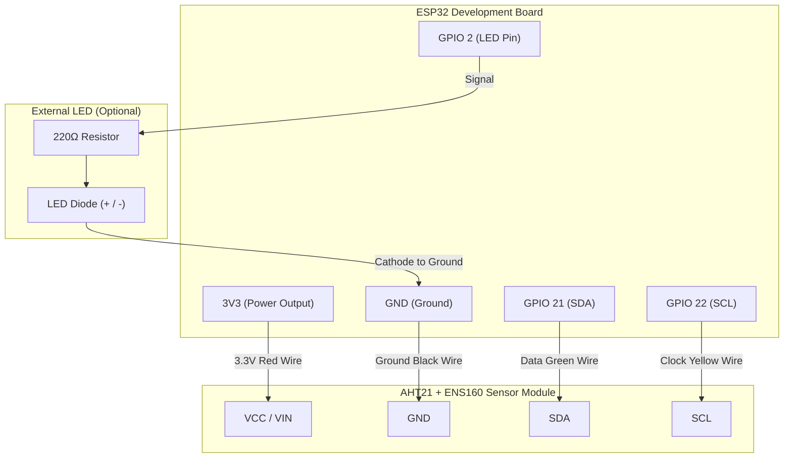

# ESP32 Hardware Wiring & Connection Guide

This guide details how to wire your **ESP32 DevKit**, the **AHT21 + ENS160 sensor module** (or separate breakout boards), and the **LED**.

---

## 1. Complete Pin-to-Pin Connection Table

### A. Sensor Connections (I2C Bus)
Whether you have a **2-in-1 combo board (AHT21 + ENS160)** or **two separate breakout boards**, both communicate over the same shared I2C bus:

| Sensor Pin | ESP32 Pin | Wire Color (Recommended) | Description |
| :--- | :--- | :--- | :--- |
| **VIN / VCC** | **3V3** | 🔴 Red | **3.3V Power** *(Do NOT connect to 5V / VIN!)* |
| **GND** | **GND** | ⚫ Black | **Common Ground** |
| **SDA** | **GPIO 21** | 🟢 Green / Blue | **I2C Serial Data** |
| **SCL** | **GPIO 22** | 🟡 Yellow | **I2C Serial Clock** |
| *ADDR (if present)* | *GND or Unconnected* | - | Default I2C address `0x53` |

> [!CAUTION]
> Always power the sensors from the ESP32's **3V3** pin. Connecting 5V to 3.3V I2C sensor logic can permanently damage the sensor chips.

---

### B. LED Connections (Actuator)

You have two options for the LED:

#### Option 1: Onboard Built-in LED (Zero extra wiring!)
Most ESP32 DevKit boards already have an internal blue LED connected to **GPIO 2**. 
- The firmware is already pre-configured to use **GPIO 2**. 
- You don't need to connect any external components—the blue onboard LED will blink/toggle directly from the dashboard!

#### Option 2: External LED (on Breadboard)
If you want an external LED:

| LED Terminal | Connection | Component |
| :--- | :--- | :--- |
| **Anode (+)** (Longer leg) | **GPIO 2** (or GPIO 4) | In series with **220Ω - 330Ω resistor** |
| **Cathode (-)** (Shorter leg / flat side) | **GND** | Connect directly to ESP32 GND rail |

---

## 2. Visual ASCII Circuit Schematic

```
                      +-------------------+
                      |   ESP32 DevKit    |
                      |                   |
        [3.3V Power]  | 3V3           GND |--- (Common Ground Rail)
                      |                   |
        [I2C Data]    | D21 (SDA)     D22 |--- [I2C Clock]
                      |                   |
        [Actuator]    | D2 (LED)          |
                      +-------------------+
                         |      |       |
                         |      |       +------------------------------------+
                         |      |                                            |
                         |      +---------------------+                      |
                         |                            |                      |
                         v                            v                      v
                +-----------------+          +-----------------+    +-----------------+
                | AHT21 + ENS160  |          |  AHT21 (Temp)   |    |  ENS160 (Air)   |
                |  Combo Board    |    OR    |  Separate Board |    |  Separate Board |
                +-----------------+          +-----------------+    +-----------------+
                | VCC  <-- 3V3    |          | VCC  <-- 3V3    |    | VCC  <-- 3V3    |
                | GND  <-- GND    |          | GND  <-- GND    |    | GND  <-- GND    |
                | SDA  <-- D21    |          | SDA  <-- D21    |    | SDA  <-- D21    |
                | SCL  <-- D22    |          | SCL  <-- D22    |    | SCL  <-- D22    |
                +-----------------+          +-----------------+    +-----------------+

             [External LED Option]
             ESP32 D2 ---> [ 220Ω Resistor ] ---> [ Anode (+) LED Cathode (-) ] ---> ESP32 GND
```

---

## 3. Mermaid Block Diagram



---

## 4. Step-by-Step Breadboard Assembly Instructions

1. **Insert the ESP32**: Place the ESP32 board straddling the center divider of your breadboard so both pin rows are accessible.
2. **Connect Ground & Power**:
   - Run a jumper wire from the ESP32 **GND** pin to the blue negative (`-`) rail on the breadboard.
   - Run a jumper wire from the ESP32 **3V3** pin to the red positive (`+`) rail on the breadboard.
3. **Connect the Sensor Module**:
   - Connect sensor **VCC** to the 3.3V red rail.
   - Connect sensor **GND** to the ground blue rail.
   - Connect sensor **SDA** to ESP32 **GPIO 21**.
   - Connect sensor **SCL** to ESP32 **GPIO 22**.
4. **Connect the External LED (Optional)**:
   - Insert the LED into the breadboard.
   - Place a 220Ω resistor between the LED's longer leg (Anode) and ESP32 **GPIO 2**.
   - Connect the shorter leg (Cathode) to the ground rail.
5. **Plug in USB**: Connect the ESP32 to your PC via USB cable.

---

## 5. Verification Checklist

- [ ] VCC is strictly connected to **3V3** (not 5V / VIN).
- [ ] SDA is on **GPIO 21**, SCL is on **GPIO 22**.
- [ ] If using an external LED, a current limiting resistor (220Ω - 330Ω) is connected.
- [ ] Open Arduino Serial Monitor at **115200 baud** after uploading. 
  - If wired properly, it will print: `[I2C] Found AHT21 sensor at 0x38` and `[I2C] Found ENS160 sensor at 0x53`.
  - If sensors are not yet plugged in, the firmware automatically starts the simulated fallback data so you can test immediately!
